# ER-диаграмма и описание 16 сущностей PizzaFlow

## 1. Схема данных (Mermaid ER-Diagram)

```mermaid
erDiagram
    USERS ||--o{ ADDRESSES : "1:N (has addresses)"
    USERS ||--o{ ORDERS : "1:N (places orders)"
    USERS ||--o| COURIERS : "1:1 (courier profile)"

    DELIVERY_ZONES ||--o{ ADDRESSES : "1:N (zone defines address)"
    DELIVERY_ZONES ||--o{ ORDERS : "1:N (zone defines delivery fee)"

    CATEGORIES ||--o{ PRODUCTS : "1:N (groups products)"
    PRODUCTS ||--o{ RECIPE_ITEMS : "1:N (product composed of)"
    INGREDIENTS ||--o{ RECIPE_ITEMS : "1:N (ingredient in recipes)"
    INGREDIENTS ||--o{ STOCK_MOVEMENTS : "1:N (audit log of stock)"

    ORDERS ||--o{ ORDER_ITEMS : "1:N (contains items)"
    PRODUCTS ||--o{ ORDER_ITEMS : "1:N (purchased in)"
    ORDERS ||--o{ STATUS_HISTORIES : "1:N (audit of transitions)"
    ORDERS ||--o| KITCHEN_ORDERS : "1:1 (kitchen ticket)"
    ORDERS ||--o| DELIVERIES : "1:1 (delivery ticket)"
    ORDERS ||--o| PAYMENTS : "1:1 (order payment)"
    PROMO_CODES ||--o{ ORDERS : "1:N (applied promo)"

    COURIERS ||--o{ DELIVERIES : "1:N (delivers orders)"

    USERS {
        bigint id PK
        varchar email UK "not null"
        varchar password_hash "not null"
        varchar full_name "not null"
        varchar phone
        varchar role "not null (CUSTOMER, COOK, COURIER, MANAGER, ADMIN)"
        timestamp created_at "not null"
    }

    ADDRESSES {
        bigint id PK
        bigint user_id FK "not null"
        bigint delivery_zone_id FK "not null"
        varchar city "not null"
        varchar street "not null"
        varchar house_number "not null"
        varchar apartment
        varchar entrance
        varchar floor
        boolean is_default "not null"
    }

    DELIVERY_ZONES {
        bigint id PK
        varchar name UK "not null"
        numeric delivery_fee "not null"
        numeric free_delivery_threshold "not null"
        integer estimated_minutes "not null"
        boolean active "not null"
    }

    CATEGORIES {
        bigint id PK
        varchar name UK "not null"
        varchar description
        integer display_order "not null"
        boolean active "not null"
    }

    PRODUCTS {
        bigint id PK
        bigint category_id FK "not null"
        varchar name UK "not null"
        varchar description
        numeric price "not null"
        varchar image_url
        integer preparation_minutes "not null"
        boolean active "not null"
    }

    INGREDIENTS {
        bigint id PK
        varchar name UK "not null"
        varchar unit "not null (G, ML, PCS)"
        numeric stock_quantity "not null"
        numeric min_stock_threshold "not null"
        numeric cost_per_unit "not null"
        bigint version "not null (@Version optimistic lock)"
    }

    RECIPE_ITEMS {
        bigint id PK
        bigint product_id FK "not null"
        bigint ingredient_id FK "not null"
        numeric quantity_required "not null"
    }

    STOCK_MOVEMENTS {
        bigint id PK
        bigint ingredient_id FK "not null"
        varchar movement_type "not null (RECEIPT, CONSUMPTION, ADJUSTMENT, WASTE)"
        numeric quantity "not null"
        numeric balance_after "not null"
        varchar reference_type "(ORDER, MANUAL, INVENTORY)"
        varchar reference_id
        varchar reason
        varchar actor "not null"
        timestamp created_at "not null"
    }

    PROMO_CODES {
        bigint id PK
        varchar code UK "not null"
        varchar discount_type "not null (PERCENTAGE, FIXED)"
        numeric discount_value "not null"
        numeric min_order_amount "not null"
        numeric max_discount_amount
        integer usage_limit
        integer times_used "not null"
        timestamp valid_from "not null"
        timestamp valid_to "not null"
        boolean active "not null"
    }

    ORDERS {
        bigint id PK
        varchar order_number UK "not null"
        bigint user_id FK "not null"
        varchar order_type "not null (DELIVERY, PICKUP)"
        varchar status "not null"
        numeric subtotal "not null"
        numeric discount_amount "not null"
        numeric delivery_fee "not null"
        numeric total_amount "not null"
        varchar promo_code_snapshot
        varchar delivery_address_snapshot
        bigint delivery_zone_id FK
        timestamp created_at "not null"
        timestamp confirmed_at
        timestamp completed_at
        timestamp cancelled_at
        varchar cancellation_reason
    }

    ORDER_ITEMS {
        bigint id PK
        bigint order_id FK "not null"
        bigint product_id FK "not null"
        varchar product_name_snapshot "not null"
        numeric unit_price "not null"
        integer quantity "not null"
        numeric line_total "not null"
    }

    STATUS_HISTORIES {
        bigint id PK
        bigint order_id FK "not null"
        varchar from_status
        varchar to_status "not null"
        varchar changed_by_username "not null"
        varchar changed_by_role "not null"
        varchar comment
        timestamp changed_at "not null"
    }

    KITCHEN_ORDERS {
        bigint id PK
        bigint order_id UK, FK "not null"
        varchar status "not null (PENDING, IN_PROGRESS, COMPLETED)"
        integer priority "not null"
        integer estimated_cooking_minutes "not null"
        timestamp started_at
        timestamp completed_at
        varchar cook_username
    }

    COURIERS {
        bigint id PK
        bigint user_id UK, FK "not null"
        varchar vehicle_type "not null (BICYCLE, SCOOTER, CAR, ON_FOOT)"
        boolean is_available "not null"
        timestamp available_since "not null"
        integer current_deliveries_count "not null"
    }

    DELIVERIES {
        bigint id PK
        bigint order_id UK, FK "not null"
        bigint courier_id FK
        varchar status "not null (PENDING_ASSIGNMENT, ASSIGNED, IN_TRANSIT, DELIVERED, CANCELLED)"
        timestamp assigned_at
        timestamp picked_up_at
        timestamp delivered_at
        varchar delivery_notes
    }

    PAYMENTS {
        bigint id PK
        bigint order_id UK, FK "not null"
        varchar payment_method "not null (CASH, CARD, ONLINE)"
        varchar payment_status "not null (PENDING, PAID, REFUNDED, FAILED)"
        numeric amount "not null"
        varchar transaction_reference
        timestamp paid_at
    }
```

---

## 2. Спецификация полей всех 16 сущностей

### 1. User (`users`) — П1
| Поле | Тип | Ограничение | Комментарий |
|---|---|---|---|
| id | Long | PK, Auto-increment | Первичный ключ |
| email | String | Unique, Not Null | Уникальный логин пользователя |
| password_hash | String | Not Null | Хэш пароля BCrypt |
| full_name | String | Not Null | Имя / ФИО пользователя |
| phone | String | Nullable | Номер телефона для курьера |
| role | Enum | Not Null | CUSTOMER, COOK, COURIER, MANAGER, ADMIN |
| created_at | Instant | Not Null | Время создания аккаунта |

*Связи*: `User 1:N Address (FK user_id)`, `User 1:N Order (FK user_id)`, `User 1:1 Courier (FK user_id)`.

---

### 2. Address (`addresses`) — П1
| Поле | Тип | Ограничение | Комментарий |
|---|---|---|---|
| id | Long | PK, Auto-increment | Первичный ключ |
| user_id | Long | FK, Not Null | Владелец адреса |
| delivery_zone_id | Long | FK, Not Null | Тарифная зона доставки |
| city | String | Not Null | Город |
| street | String | Not Null | Улица |
| house_number | String | Not Null | Номер дома |
| apartment | String | Nullable | Номер квартиры / офиса |
| entrance | String | Nullable | Подъезд |
| floor | String | Nullable | Этаж |
| is_default | Boolean | Not Null | Приоритетный адрес клиента |

*Связи*: `Address N:1 User`, `Address N:1 DeliveryZone`.

---

### 3. DeliveryZone (`delivery_zones`) — П3
| Поле | Тип | Ограничение | Комментарий |
|---|---|---|---|
| id | Long | PK, Auto-increment | Первичный ключ |
| name | String | Unique, Not Null | Название зоны (Центр, Север, Юг) |
| delivery_fee | BigDecimal | Not Null | Базовая стоимость доставки |
| free_delivery_threshold | BigDecimal | Not Null | Порог суммы заказа для бесплатной доставки |
| estimated_minutes | Integer | Not Null | Расчетное время доставки в зону (мин.) |
| active | Boolean | Not Null | Активна ли зона |

---

### 4. Category (`categories`) — П2
| Поле | Тип | Ограничение | Комментарий |
|---|---|---|---|
| id | Long | PK, Auto-increment | Первичный ключ |
| name | String | Unique, Not Null | Наименование категории (Пиццы, Напитки...) |
| description | String | Nullable | Описание категории |
| display_order | Integer | Not Null | Порядок вывода на витрине |
| active | Boolean | Not Null | Флаг активности |

*Связи*: `Category 1:N Product (FK category_id)`.

---

### 5. Product (`products`) — П2
| Поле | Тип | Ограничение | Комментарий |
|---|---|---|---|
| id | Long | PK, Auto-increment | Первичный ключ |
| category_id | Long | FK, Not Null | Категория блюда |
| name | String | Unique, Not Null | Название продукта (например, "Пепперони 30см") |
| description | String | Nullable | Состав и вкус |
| price | BigDecimal | Not Null | Розничная цена |
| image_url | String | Nullable | Изображение блюда |
| preparation_minutes | Integer | Not Null | Среднее время готовки (для нагрузки кухни) |
| active | Boolean | Not Null | Доступен ли к заказу |

*Связи*: `Product N:1 Category`, `Product 1:N RecipeItem`, `Product 1:N OrderItem`.

---

### 6. Ingredient (`ingredients`) — П2
| Поле | Тип | Ограничение | Комментарий |
|---|---|---|---|
| id | Long | PK, Auto-increment | Первичный ключ |
| name | String | Unique, Not Null | Название сырья (Сыр Моцарелла, Тесто...) |
| unit | Enum | Not Null | Единица измерения (G, ML, PCS) |
| stock_quantity | BigDecimal | Not Null | Фактический остаток на складе |
| min_stock_threshold | BigDecimal | Not Null | Минимальный безопасный остаток (порог тревоги) |
| cost_per_unit | BigDecimal | Not Null | Себестоимость за единицу |
| version | Long | Not Null, @Version | Поле оптимистической блокировки (защита от гонок) |

*Связи*: `Ingredient 1:N RecipeItem`, `Ingredient 1:N StockMovement`.

---

### 7. RecipeItem (`recipe_items`) — П2
| Поле | Тип | Ограничение | Комментарий |
|---|---|---|---|
| id | Long | PK, Auto-increment | Первичный ключ |
| product_id | Long | FK, Not Null | Продукт меню |
| ingredient_id | Long | FK, Not Null | Ингредиент |
| quantity_required | BigDecimal | Not Null | Норма расхода на 1 шт. продукта |

*Связи*: Связующая таблица отношения `Product N:M Ingredient` с дополнительным атрибутом количества.

---

### 8. StockMovement (`stock_movements`) — П2
| Поле | Тип | Ограничение | Комментарий |
|---|---|---|---|
| id | Long | PK, Auto-increment | Первичный ключ |
| ingredient_id | Long | FK, Not Null | Ссылается на сырье |
| movement_type | Enum | Not Null | RECEIPT, CONSUMPTION, ADJUSTMENT, WASTE |
| quantity | BigDecimal | Not Null | Количество изменения (+ или -) |
| balance_after | BigDecimal | Not Null | Баланс остатка после операции |
| reference_type | String | Nullable | Источник: ORDER, MANUAL, INVENTORY |
| reference_id | String | Nullable | ID заказа или накладной |
| reason | String | Nullable | Комментарий к проводке |
| actor | String | Not Null | Логин ответственного сотрудника |
| created_at | Instant | Not Null | Время совершения проводки |

---

### 9. PromoCode (`promo_codes`) — П1
| Поле | Тип | Ограничение | Комментарий |
|---|---|---|---|
| id | Long | PK, Auto-increment | Первичный ключ |
| code | String | Unique, Not Null | Кодовое слово (WELCOME10, PIZZA20) |
| discount_type | Enum | Not Null | PERCENTAGE или FIXED |
| discount_value | BigDecimal | Not Null | Размер скидки (например, 20% или 150 руб) |
| min_order_amount | BigDecimal | Not Null | Минимальная сумма заказа для активации |
| max_discount_amount | BigDecimal | Nullable | Предельный размер скидки (для процентов) |
| usage_limit | Integer | Nullable | Максимальное число использований (всего) |
| times_used | Integer | Not Null | Фактически использовано раз |
| valid_from | Instant | Not Null | Начало действия |
| valid_to | Instant | Not Null | Конец действия |
| active | Boolean | Not Null | Флаг активности |

---

### 10. Order (`orders`) — П1 (Ядро системы)
| Поле | Тип | Ограничение | Комментарий |
|---|---|---|---|
| id | Long | PK, Auto-increment | Первичный ключ |
| order_number | String | Unique, Not Null | Человекочитаемый номер (PF-20261019-XXXX) |
| user_id | Long | FK, Not Null | Заказчик |
| order_type | Enum | Not Null | DELIVERY или PICKUP |
| status | Enum | Not Null | Единый главный статус заказа |
| subtotal | BigDecimal | Not Null | Сумма позиций без скидок |
| discount_amount | BigDecimal | Not Null | Сумма предоставленной скидки |
| delivery_fee | BigDecimal | Not Null | Стоимость доставки |
| total_amount | BigDecimal | Not Null | Итого к оплате (subtotal - discount + fee) |
| promo_code_snapshot | String | Nullable | Снепшот промокода на момент заказа |
| delivery_address_snapshot | String | Nullable | Снепшот адреса доставки текстом |
| delivery_zone_id | Long | FK, Nullable | Зона доставки (если DELIVERY) |
| created_at | Instant | Not Null | Время оформления |
| confirmed_at | Instant | Nullable | Время подтверждения менеджером |
| completed_at | Instant | Nullable | Время вручения / выдачи |
| cancelled_at | Instant | Nullable | Время отмены |
| cancellation_reason | String | Nullable | Причина аннулирования |

*Связи*: `Order 1:N OrderItem`, `Order 1:N StatusHistory`, `Order 1:1 KitchenOrder`, `Order 1:1 Delivery`, `Order 1:1 Payment`.

---

### 11. OrderItem (`order_items`) — П1
| Поле | Тип | Ограничение | Комментарий |
|---|---|---|---|
| id | Long | PK, Auto-increment | Первичный ключ |
| order_id | Long | FK, Not Null | Ссылка на заказ |
| product_id | Long | FK, Not Null | Ссылка на продукт |
| product_name_snapshot | String | Not Null | Снепшот наименования блюда |
| unit_price | BigDecimal | Not Null | Снепшот цены за единицу на момент заказа |
| quantity | Integer | Not Null | Количество единиц |
| line_total | BigDecimal | Not Null | unit_price * quantity |

---

### 12. StatusHistory (`status_histories`) — П1
| Поле | Тип | Ограничение | Комментарий |
|---|---|---|---|
| id | Long | PK, Auto-increment | Первичный ключ |
| order_id | Long | FK, Not Null | Ссылка на заказ |
| from_status | String | Nullable | Предыдущий статус |
| to_status | String | Not Null | Новый статус |
| changed_by_username | String | Not Null | Логин инициатора смены статуса |
| changed_by_role | String | Not Null | Роль инициатора |
| comment | String | Nullable | Комментарий к переходу |
| changed_at | Instant | Not Null | Точное время фиксации |

---

### 13. KitchenOrder (`kitchen_orders`) — П2
| Поле | Тип | Ограничение | Комментарий |
|---|---|---|---|
| id | Long | PK, Auto-increment | Первичный ключ |
| order_id | Long | Unique, FK, Not Null | Связанный заказ |
| status | Enum | Not Null | PENDING, IN_PROGRESS, COMPLETED |
| priority | Integer | Not Null | Приоритет в очереди |
| estimated_cooking_minutes | Integer | Not Null | Оценка времени готовки наряда |
| started_at | Instant | Nullable | Время начала списания и выпечки |
| completed_at | Instant | Nullable | Время готовности блюда |
| cook_username | String | Nullable | Повар, взявший наряд |

---

### 14. Courier (`couriers`) — П3
| Поле | Тип | Ограничение | Комментарий |
|---|---|---|---|
| id | Long | PK, Auto-increment | Первичный ключ |
| user_id | Long | Unique, FK, Not Null | Ссылка на пользователя с ролью COURIER |
| vehicle_type | Enum | Not Null | BICYCLE, SCOOTER, CAR, ON_FOOT |
| is_available | Boolean | Not Null | Свободен ли для новых доставок |
| available_since | Instant | Not Null | Время освобождения (для очереди FIFO) |
| current_deliveries_count | Integer | Not Null | Число активных доставок (0 или 1) |

---

### 15. Delivery (`deliveries`) — П3
| Поле | Тип | Ограничение | Комментарий |
|---|---|---|---|
| id | Long | PK, Auto-increment | Первичный ключ |
| order_id | Long | Unique, FK, Not Null | Доставляемый заказ |
| courier_id | Long | FK, Nullable | Назначенный курьер (если назначен) |
| status | Enum | Not Null | PENDING_ASSIGNMENT, ASSIGNED, IN_TRANSIT, DELIVERED, CANCELLED |
| assigned_at | Instant | Nullable | Время назначения курьера |
| picked_up_at | Instant | Nullable | Время забора заказа курьером |
| delivered_at | Instant | Nullable | Время вручения клиенту |
| delivery_notes | String | Nullable | Пожелания по доставке (код домофона и т.д.) |

---

### 16. Payment (`payments`) — П3
| Поле | Тип | Ограничение | Комментарий |
|---|---|---|---|
| id | Long | PK, Auto-increment | Первичный ключ |
| order_id | Long | Unique, FK, Not Null | Оплачиваемый заказ |
| payment_method | Enum | Not Null | CASH, CARD, ONLINE |
| payment_status | Enum | Not Null | PENDING, PAID, REFUNDED, FAILED |
| amount | BigDecimal | Not Null | Сумма транзакции (равна total_amount заказа) |
| transaction_reference | String | Nullable | Внешний идентификатор транзакции / чека |
| paid_at | Instant | Nullable | Время подтверждения оплаты |
