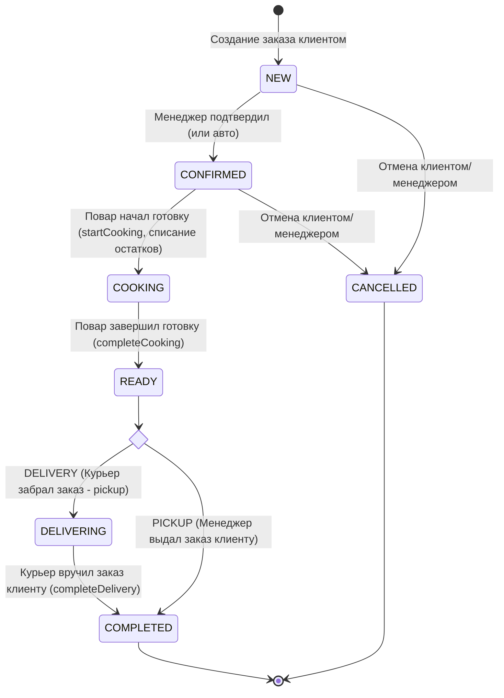

# Статусная модель и переходы (Status Flow)

## 1. Концепция единого статуса
В PizzaFlow действует фундаментальное архитектурное правило: **главный статус жизненного цикла заказа хранится исключительно в сущности `Order`**.  
Смежные сущности (`KitchenOrder`, `Delivery`) имеют вспомогательные локальные состояния, но синхронизируются с главным заказом **только через единую точку входа**: `OrderService.changeStatus(orderId, newStatus, actorUsername, actorRole)`.  
Это гарантирует:
- Невозможность рассинхронизации статусов между сервисами.
- Гарантированную запись в журнал `StatusHistory` при любом переходе.
- Проверку бизнес-правил и ролевых ограничений в одном централизованном месте.

---

## 2. Диаграмма переходов состояний (State Diagram)

---

## 3. Таблица разрешённых переходов

| Исходный статус (From) | Целевой статус (To) | Условие / Тип заказа | Кто инициирует (Роль) | Бизнес-действие в системе |
|---|---|---|---|---|
| `NEW` | `CONFIRMED` | Любой | MANAGER, ADMIN | Менеджер принял заказ. Создаётся `KitchenOrder` со статусом `PENDING`. |
| `NEW` | `CANCELLED` | Любой | CUSTOMER (свой заказ), MANAGER, ADMIN | Отмена до подтверждения. Промокод освобождается. |
| `CONFIRMED` | `COOKING` | Любой | COOK, MANAGER, ADMIN | Повар нажал «Готовить». Списываются ингредиенты со склада (`StockMovement = CONSUMPTION`). |
| `CONFIRMED` | `CANCELLED` | Любой | CUSTOMER (свой), MANAGER, ADMIN | Отмена до выпечки. Если оплачено онлайн — инициация возврата (`REFUNDED`). |
| `COOKING` | `READY` | Любой | COOK, MANAGER, ADMIN | Повар нажал «Готово». Если `DELIVERY` — создаётся `Delivery` и запускается поиск курьера (FIFO). |
| `READY` | `DELIVERING` | Только `DELIVERY` | COURIER (назначенный), MANAGER | Курьер забрал коробки из ресторана (`Delivery = IN_TRANSIT`). |
| `READY` | `COMPLETED` | Только `PICKUP` | MANAGER, ADMIN | Клиент забрал заказ в пиццерии. Оплата переводится в `PAID`. |
| `DELIVERING` | `COMPLETED` | Только `DELIVERY` | COURIER (назначенный), MANAGER | Заказ доставлен клиенту. Платёж закрыт в `PAID`, курьер освобождён. |

---

## 4. Запрещённые переходы и логика защиты

Все остальные комбинации переходов **строго запрещены**. При попытке выполнить недопустимый переход система генерирует контролируемое исключение:
- **`InvalidStatusTransitionException`** (мапится в HTTP 400 Bad Request или HTTP 409 Conflict) с детальным текстом:  
  `"Недопустимый переход статуса заказа #PF-XXXX из [COOKING] в [CANCELLED]. Причина: ингредиенты уже списаны со склада."`

### Обоснование ключевых запретов:
1. **Запрет `COOKING -> CANCELLED`**:  
   При переходе в `COOKING` сырье (мука, сыр, мясо) уже израсходовано и термически обработано. Автоматическая отмена клиентом невозможна, так как повлечёт прямой ущерб ресторану.
2. **Запрет `READY -> DELIVERING` для самовывоза (`PICKUP`)**:  
   Для самовывоза курьерская доставка не предусмотрена; заказ выдаётся непосредственно в ресторане с моментальным переходом в `COMPLETED`.
3. **Запрет возврата назад (`COMPLETED -> READY`, `READY -> COOKING`)**:  
   Жизненный цикл заказа является строго однонаправленным. Исправление ошибок осуществляется через ручные корректирующие проводки на складе и возвраты средств, но не откатом статуса.
