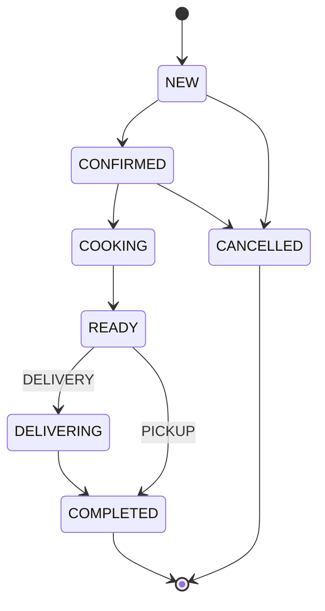

# Order: модель, статусы, переходы

Владелец: **Ксюша (П1)**, модуль `com.pizzaflow.orders`. Менять только по согласованию всех троих.

Пометка **решение** означает, что пункт выбран за команду, чтобы можно было начать работу. Если не согласны, замените его здесь, остальные файлы это не затронет.

Приложение на JavaFX, HTTP-эндпоинтов нет: экраны вызывают сервисы напрямую, а ошибки приходят исключениями и показываются в Alert.

## 1. Сущности

### Order

| Поле | Тип | Правило |
|---|---|---|
| `id` | `Long` | PK |
| `orderNumber` | `String`, unique | формат `PF-yyyyMMdd-NNNN`, номер за день растёт с `0001` |
| `user` | связь на `User` | клиент; при заказе от имени клиента сотрудник выбирает клиента |
| `orderType` | enum `DELIVERY` / `PICKUP` | `STRING` |
| `status` | enum `OrderStatus` | `STRING`, стартовый `NEW` |
| `paymentMethod` | enum `CASH` / `CARD` | добавлено из requirements.md (экран «Новый заказ») |
| `subtotal` | `BigDecimal` `numeric(12,2)` | сумма позиций |
| `discountAmount` | `BigDecimal` | скидка по промокоду, по умолчанию `0` |
| `deliveryFee` | `BigDecimal` | по зоне доставки; для `PICKUP` = `0` |
| `totalAmount` | `BigDecimal` | `subtotal - discountAmount + deliveryFee` |
| `promoCode` | `String`, nullable | |
| `deliveryAddress` | `String`, nullable | снимок текстом на момент заказа; для `PICKUP` = null |
| `deliveryZone` | связь на `DeliveryZone`, nullable | для `PICKUP` = null |
| `createdAt` | `Instant` | при создании |
| `confirmedAt` | `Instant` | при переходе в `CONFIRMED` |
| `completedAt` | `Instant` | при переходе в `COMPLETED` |
| `cancelledAt` | `Instant` | при переходе в `CANCELLED` |

Поля `version` у Order нет (оно только у `Ingredient`).

### OrderItem (1:N к Order)

`id`, `order`, `menuItemId`, `itemName` (снимок), `unitPrice` (снимок), `quantity`, `lineTotal`. Название и цену копируем в момент заказа, чтобы изменение меню не меняло старые заказы.

### StatusHistory (1:N к Order)

`id`, `order`, `fromStatus` (null у первой записи), `toStatus`, `changedBy` (User), `changedAt`, `comment` (например, причина отмены). Пишется только внутри `OrderService.changeStatus`; первая запись (`null → NEW`) создаётся при оформлении заказа.

## 2. Расчёт суммы (в одном месте: `OrderService`)

1. `subtotal` = сумма `unitPrice * quantity`. Цены берём из меню в момент создания заказа.
2. `discountAmount` = `subtotal * percent / 100` по промокоду; нет промокода или он неактивен, значит `0`. Скидка не больше `subtotal`.
3. `deliveryFee` = тариф зоны для `DELIVERY`, `0` для `PICKUP`.
4. `totalAmount` = `subtotal - discountAmount + deliveryFee`.
5. Округление `HALF_UP` до 2 знаков.

Недоступную позицию меню добавить в заказ нельзя (`MenuItemUnavailableException`).

## 3. Статусы и переходы

`NEW`, `CONFIRMED`, `COOKING`, `READY`, `DELIVERING`, `COMPLETED`, `CANCELLED`. `COMPLETED` и `CANCELLED` конечные.

| Из | В | Кто может | Условие |
|---|---|---|---|
| `NEW` | `CONFIRMED` | MANAGER, ADMIN | |
| `NEW` | `CANCELLED` | CUSTOMER (только свой заказ), MANAGER, ADMIN | |
| `CONFIRMED` | `CANCELLED` | CUSTOMER (только свой заказ), MANAGER, ADMIN | |
| `CONFIRMED` | `COOKING` | COOK | |
| `COOKING` | `READY` | COOK | |
| `READY` | `DELIVERING` | COURIER | только `DELIVERY` |
| `READY` | `COMPLETED` | MANAGER, ADMIN | только `PICKUP` |
| `DELIVERING` | `COMPLETED` | COURIER | только `DELIVERY` |

Всё, чего нет в таблице, запрещено.

**Решение:** MANAGER и ADMIN могут выполнить любой разрешённый переход вместо исполнителя (повар или курьер отсутствует; на демо весь поток можно провести одним человеком). Это одна проверка в коде, убрать её просто.

**Решение:** подтверждение заказа ручное, `NEW → CONFIRMED` делает менеджер.

**Решение:** после `COOKING` отмена запрещена. Ингредиенты списываются в момент `COOKING`, поэтому до него возвращать на склад нечего.

## 4. Как работает `OrderService.changeStatus`

Единственное место, где меняется статус. Один метод, одна транзакция, шаги по порядку:

1. Найти заказ, иначе `OrderNotFoundException`.
2. Проверить, что переход есть в таблице и подходит под `orderType`, иначе `InvalidStatusTransitionException`.
3. Проверить роль (и что `CUSTOMER` отменяет свой заказ), иначе `ForbiddenActionException`.
4. Записать новый статус и время (`confirmedAt`, `cancelledAt`, `completedAt`).
5. Добавить запись в `StatusHistory`.
6. Записать строку в аудит-лог (`AuditLogger`).
7. Опубликовать `OrderStatusChangedEvent`.

Любое исключение откатывает всю транзакцию. Тексты исключений на русском, они показываются в Alert, например: «Нельзя перевести заказ из статуса «Готовится» в «Новый»».

## 5. Что делают соседи при смене статуса

`OrderService` соседние модули не вызывает: они сами слушают событие (см. `api-contract.md`).

| Новый статус | Алина (кухня) | Алия (доставка) |
|---|---|---|
| `CONFIRMED` | создать `KitchenOrder`, заказ появляется в очереди «Новые» | |
| `COOKING` | списать ингредиенты по рецептам, записать повара и `startedAt` | |
| `READY` | записать `finishedAt` | если `DELIVERY`: создать `Delivery` и назначить курьера |
| `DELIVERING` | | доставка в статус «В пути» |
| `COMPLETED` | | если `DELIVERY`: доставка в статус «Доставлено» |
| `CANCELLED` | убрать `KitchenOrder` из очереди | |

Если слушатель бросает исключение (например, не хватает ингредиента), статус не меняется и пользователь видит сообщение.
